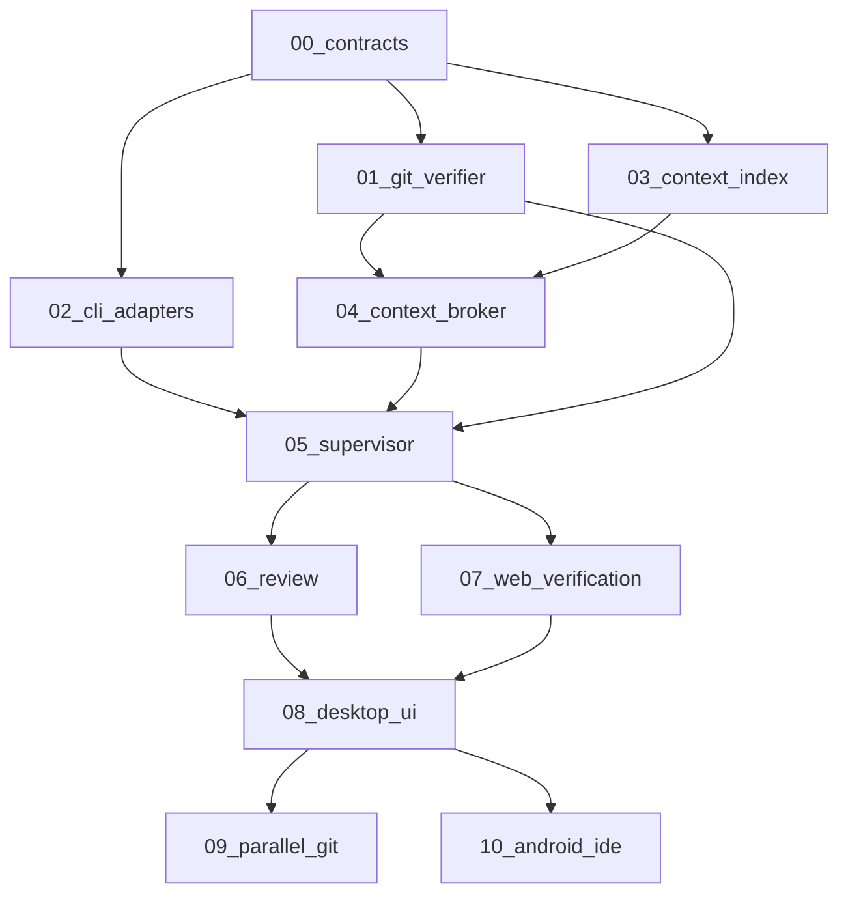

# ADW Implementation Plans — Master Index

> **Source TZ:** `Agent_Development_Workstation_Architecture_v1.docx` (v1.0 · 30 Oct 2026)  
> **For agentic workers:** execute chunks in dependency order using `@superpowers:subagent-driven-development` (or `@superpowers:executing-plans`). Do not skip DoD-wave gates.

**Product:** Agent Development Workstation — local desktop dispatcher for full-cycle AI development (not a code editor).  
**Core value:** interchangeable coding agents + shared context + independent verification.

## Current execution status (2026-11-10)

- **00:** acceptance checks passed; [report](../../implementation/00-status.md).
- **01:** implemented, Linux acceptance checks passed; [report](../../implementation/01-status.md).
- **02:** implemented; fake-CLI tests and installed-CLI version/help probes passed on Linux; [report](../../implementation/02-status.md).
- **03:** implemented; Project Map, immutable snapshots, FTS/ripgrep and incremental/resource checks passed; [report](../../implementation/03-status.md).
- **04:** implemented; ArtifactStore, scoped APIs, provenance/freshness and budgeted bundles passed checks; [report](../../implementation/04-status.md).
- **05:** implemented; spec lock, serial DAG, routing, bounded fixes and green/red headless pilots passed; [report](../../implementation/05-status.md).
- **06:** implemented; independent code/security sessions, structured verdicts, blocking findings and reviewed human acceptance; [report](../../implementation/06-status.md).
- **07:** real HTTP/Chromium green + forced-red gate passed; durable media/CAS/journals saved; [report](../../implementation/07-status.md).
- **08:** Electron/React UI and compiled Node core implemented; build and 317 tests pass. Real web gate passed; native Electron 38.8.6 startup smoke passed with sandbox enabled. Manual real-CLI DoD pending; [report](../../implementation/08-status.md).
- Root validation: `pnpm typecheck` and `pnpm test` pass (317 tests; 2 optional live probes skipped by default; installed-CLI probes passed separately in chunk 02).
- Review fixes for chunks 00–02: all four confirmed findings fixed with regression coverage; [report](../../implementation/2026-10-31-review-fixes.md).
- Commits remain unavailable: workspace `.git` metadata is empty and mounted read-only. This exception does not waive later DoD/review gates.

## Monorepo layout (locked in chunk 00)

```
apps/desktop/          # Electron + React (chunk 08)
packages/core/         # headless Local Core Service
packages/contracts/    # Zod types + IPC schemas
packages/cli-adapters/ # Codex / Claude
packages/context/      # indexer + broker
packages/git/          # worktrees + acceptance
packages/verifier/     # checks + evidence
packages/supervisor/   # state machine + DAG
fixtures/demo-repo/    # TypeScript/Node/React demo
docs/superpowers/plans/
```

## Dependency graph



## Chunk map

| Chunk | Plan file | TZ / TASK | Wave | Result |
|-------|-----------|-----------|------|--------|
| 00 | [2026-10-31-adw-00-contracts.md](./2026-10-31-adw-00-contracts.md) | §3 Store, §11, TASK-01 | A DoD | Zod contracts, SQLite schema, demo fixture, config |
| 01 | [2026-10-31-adw-01-git-verifier.md](./2026-10-31-adw-01-git-verifier.md) | §7–8, TASK-02/03 | A DoD | GitWorktreeManager + VerifierRunner (no LLM) |
| 02 | [2026-10-31-adw-02-cli-adapters.md](./2026-10-31-adw-02-cli-adapters.md) | §5, TASK-04/05/06 | A DoD | CapabilityManifest, AgentAdapter, Codex+Claude |
| 03 | [2026-10-31-adw-03-context-index.md](./2026-10-31-adw-03-context-index.md) | §4.1 L1, TASK-07 | A DoD | ProjectIndexer (ripgrep/FTS/symbols) |
| 04 | [2026-10-31-adw-04-context-broker.md](./2026-10-31-adw-04-context-broker.md) | §4.2–4.6, TASK-08/09 | A DoD | Artifacts, provenance, ContextBundle |
| 05 | [2026-10-31-adw-05-supervisor.md](./2026-10-31-adw-05-supervisor.md) | §6, TASK-10 | A DoD | Spec lock, DAG, routing, e2e pilot |
| 06 | [2026-10-31-adw-06-review.md](./2026-10-31-adw-06-review.md) | §6 Reviewer, §8 | A DoD | Cross-agent review, blocking remarks |
| 07 | [2026-10-31-adw-07-web-verification.md](./2026-10-31-adw-07-web-verification.md) | §8 Web | A DoD | API smoke + Playwright evidence |
| 08 | [2026-10-31-adw-08-desktop-ui.md](./2026-10-31-adw-08-desktop-ui.md) | §10–11 Desktop | A DoD | Electron UI: ticket → accept/reject |
| 09 | [2026-10-31-adw-09-parallel-git.md](./2026-10-31-adw-09-parallel-git.md) | roadmap 9 | B post | Worker worktrees, merge/conflicts |
| 10 | [2026-10-31-adw-10-android-ide.md](./2026-10-31-adw-10-android-ide.md) | roadmap 10 | B post | Optional ADB + IDE bridge |

## Execution order

1. **00** → foundation (must be first).
2. **01, 02, 03** can proceed in parallel after 00 (separate worktrees/agents).
3. **04** after 01 + 03.
4. **05** after 02 + 04 (+ 01).
5. **06** and **07** after 05 (parallel).
6. **08** after 06 + 07 → **DoD gate**.
7. **09**, **10** only after DoD accepted.

## DoD gate (TZ §16)

On one real TypeScript/Node/React repo the user:

1. Selects base branch.
2. Approves locked task spec + acceptance.
3. Supervisor assigns a CLI agent.
4. Agent runs in a worktree with a Context Bundle.
5. Workstation independently verifies changes.
6. A separate reviewer analyzes the diff.
7. User sees evidence and accepts or rejects the patch.

Process must be reproducible from the audit journal; context artifacts must have provenance and freshness status.

**Initial quality gates (TZ §13, targets not promises):**

- 0 false-green on known-failing required checks.
- 100% artifacts with base SHA + provenance.
- 100% stops on budget/timeout.
- Measure token/reuse metrics before optimizing router.

## Explicit non-goals (all chunks)

- Fork of VS Code / full source editor.
- Homegrown universal LLM.
- Auto push/merge to `main`.
- Parsing ANSI terminal as primary protocol.
- Extracting subscription tokens / bypassing provider limits.
- Treating worktree as a sandbox (OS/process/network/secret isolation is separate).

## Open risks (TZ §14) — track per chunk

- CLI headless JSON/events/resume/MCP vary by version → compatibility matrix in chunk 02.
- Subscription ToS/quotas may limit automation → verify before user promises.
- Semantic merge can break API contracts without text conflicts → chunks 07/09.
- Compression can distort decisions → provenance mandatory (chunk 04).
- Large monorepo index cost → incremental + resource limits (chunk 03).
- OS differences for sandbox/PTY/Android → chunks 02/10.
- Which actions need extra human approval beyond spec lock + final accept → decide in 05/08.
